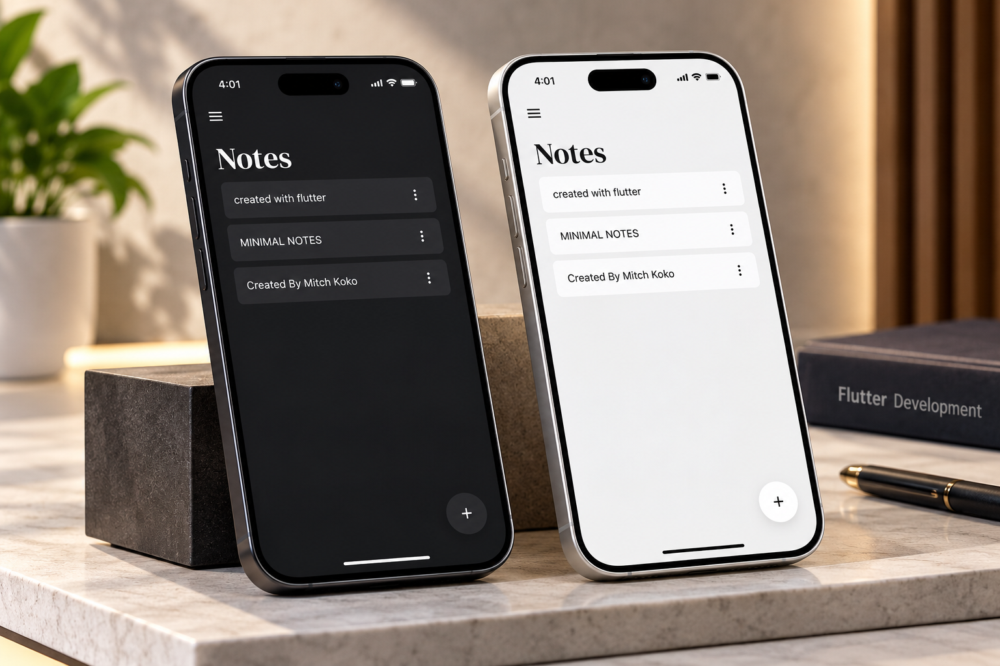

<div align="center">

# ✅ To-Do App with SQLite

### Flutter • Dart • SQLite • Local Data Storage

A modern and lightweight **To-Do List Application** built with Flutter and SQLite, designed to help users organize daily tasks and manage their productivity.

The application demonstrates local database integration, task management, and persistent data storage using Flutter.


</div>

---

## 📸 Project Preview

<div align="center">

<a href="64c2076a-87cb-4752-8126-9dddfaf1713e.png">
  
</a>

</div>

---

## 📖 About the Project

**To-Do App with SQLite** is a Flutter-based task management application that uses SQLite for local data persistence.

The project focuses on building a practical productivity application while implementing database operations and interactive Flutter user interfaces.

Users can organize their daily activities through a simple task management experience.

Unlike cloud-based task management systems, SQLite enables task data to be stored locally on the device without requiring a remote database server.

---

## ✨ Key Features

### 📝 Task Management

- Create new tasks.
- View existing tasks.
- Update task information.
- Delete unwanted tasks.
- Organize daily activities.

### ✅ Task Completion

- Mark tasks as completed.
- Track pending tasks.
- Manage task completion status.
- Update task states through the application interface.

### 🗄️ SQLite Local Database

- Store task information locally.
- Perform CRUD database operations.
- Retrieve saved tasks.
- Update existing database records.
- Delete tasks from local storage.
- Preserve task data between application sessions.

### 🎨 Modern Flutter UI

- Clean and intuitive interface.
- Organized task list layout.
- Interactive task controls.
- Reusable Flutter widgets.
- Responsive mobile design.
- Simple navigation.

---

## 🛠️ Technologies Used

| Technology | Purpose |
|------------|---------|
| Flutter | Cross-platform UI development |
| Dart | Application logic |
| SQLite | Local database storage |
| Android Studio / VS Code | Development environment |
| Git | Version control |
| GitHub | Source code hosting |

---

## 🏗️ Application Architecture

```text
             To-Do Application
                     |
                     v
               Flutter UI
                     |
                     v
             Task Management
                     |
                     v
              Database Layer
                     |
                     v
                SQLite DB
                     |
         +-----------+-----------+
         |           |           |
         v           v           v
       Create       Read       Update
                                 |
                                 v
                               Delete
```

This diagram illustrates the core task-management and persistence workflow.

---

## 🔄 CRUD Operations

The application demonstrates the four fundamental database operations:

| Operation | Description |
|-----------|-------------|
| CREATE | Add a new task to the database |
| READ | Retrieve and display stored tasks |
| UPDATE | Modify task details or completion status |
| DELETE | Remove a task from the database |

### Example Task Data Model

A typical task record may contain:

```dart
class Task {
  final int? id;
  final String title;
  final String? description;
  final bool isCompleted;

  Task({
    this.id,
    required this.title,
    this.description,
    this.isCompleted = false,
  });
}
```

This is an illustrative model and may differ from the actual implementation.

---

## 📱 Application Workflow

```text
               Open App
                   |
                   v
           Load Saved Tasks
                   |
                   v
             Display Tasks
                   |
          +--------+--------+
          |        |        |
          v        v        v
       Add Task  Edit Task  Delete Task
          |        |        |
          +--------+--------+
                   |
                   v
            Update SQLite
                   |
                   v
             Refresh UI
```

---

## 📂 Project Structure

Based on the repository listing:

```text
Todo-App-SQLITE/
│
├── android/
├── images/
├── ios/
├── lib/
├── linux/
├── macos/
├── test/
├── web/
├── windows/
│
├── 64c2076a-87cb-4752-8126-9dddfaf1713e.png
├── .gitignore
├── .metadata
├── analysis_options.yaml
├── pubspec.yaml
├── pubspec.lock
└── README.md
```

### Main Directories

**`lib/`**

Contains the Dart source code for the Flutter application.

**`images/`**

Contains image assets used by the project.

**`android/` and `ios/`**

Mobile platform configuration.

**`test/`**

Flutter testing directory.

**`pubspec.yaml`**

Defines the Flutter project dependencies and assets.

---

## 🚀 Getting Started

### Prerequisites

Make sure you have installed:

- Flutter SDK
- Dart SDK
- Android Studio or VS Code
- Android emulator or physical device
- Git

### 1. Clone the Repository

```bash
git clone https://github.com/AhmedJaberAhmed/Todo-App-SQLITE.git
```

### 2. Navigate to the Project

```bash
cd Todo-App-SQLITE
```

### 3. Install Dependencies

```bash
flutter pub get
```

### 4. Check Available Devices

```bash
flutter devices
```

### 5. Run the Application

```bash
flutter run
```

### 6. Run Tests

```bash
flutter test
```

**Note:** SQLite plugin support varies by platform. Run the project on a platform supported by its configured SQLite package.

---

## 💾 Local Data Persistence

One of the key concepts demonstrated in this project is **local data persistence**.

With SQLite, application data can remain available after the user closes and reopens the application.

### Benefits of SQLite

- Lightweight database engine.
- No external database server required.
- Suitable for offline-first applications.
- Supports structured SQL queries.
- Efficient storage for local application data.
- Useful for mobile productivity applications.

---

## 💡 Development Highlights

This project demonstrates practical experience in:

- Flutter mobile application development.
- Dart programming.
- SQLite database integration.
- CRUD operations.
- Local data persistence.
- Task state management.
- Building reusable Flutter widgets.
- Creating productivity-focused user interfaces.

---

## 🎯 Project Goals

- Build a functional task management application.
- Practice Flutter and Dart development.
- Implement SQLite database operations.
- Store and retrieve tasks locally.
- Improve application data management skills.
- Create an intuitive and responsive interface.

---

## 🔮 Potential Future Improvements

- 🔔 Task reminders and notifications.
- 📅 Task deadlines and scheduling.
- 🏷️ Task categories and labels.
- 🔍 Task search and filtering.
- ⭐ Priority levels.
- 🌙 Dark and light themes.
- ☁️ Optional cloud synchronization.
- 📊 Productivity statistics.
- 🔁 Recurring tasks.
- 📤 Task backup and export.

---

## 👨‍💻 Developer

**Ahmed Jaber Ahmed**

Flutter Developer | Mobile App Developer

B.Sc. Computer Science & Artificial Intelligence

📍 Cairo, Egypt

- [GitHub](https://github.com/AhmedJaberAhmed)
- [Portfolio](https://ahmedjaberahmed.github.io/Jaber-website/)
- [LinkedIn](https://www.linkedin.com/in/ahmedjaberahmed/)

---

<div align="center">

### ⭐ Support the Project

If you find this project interesting, consider giving it a star!

**Built with Flutter 💙 and SQLite 🗄️**

</div>
